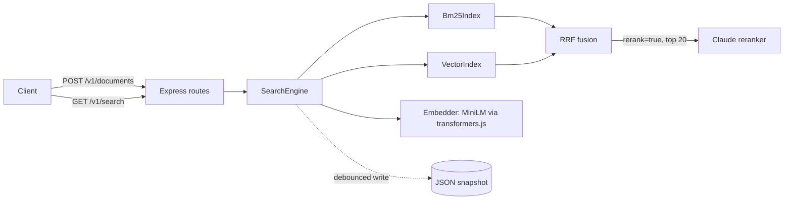

# hybrid-search-api

Hybrid search API: hand-built BM25 + vector search + RRF fusion + optional LLM reranking.

[](https://github.com/Muhaman/hybrid-search-api/actions/workflows/ci.yml)

## What it does

- Indexes documents (`id`, `title`, `text`) in memory and persists them to a JSON snapshot.
- Searches with three modes: `bm25` (lexical), `vector` (semantic, local MiniLM embeddings), and `hybrid` (both, fused with Reciprocal Rank Fusion).
- Optionally reranks the top 20 candidates with a Claude model that grades relevance 0-3 via structured output.
- Ships a small benchmark (nDCG@10 and MRR per mode) that runs in CI on a synthetic labelled dataset.

BM25, the vector index, tokenizer and fusion are written from scratch; no search library is used.

## Architecture



## Quickstart

```bash
cp .env.example .env        # ANTHROPIC_API_KEY is optional; only rerank=true needs it
npm install
npm run dev                 # http://localhost:3000
```

The first request that needs embeddings downloads `Xenova/all-MiniLM-L6-v2` into `.model-cache`.

Docker:

```bash
docker build -t hybrid-search-api .
docker run -p 3000:3000 -v search-data:/app/data --env-file .env hybrid-search-api
```

Configuration (all optional): `ANTHROPIC_API_KEY`, `RERANK_MODEL` (default `claude-haiku-5-5`), `PORT`, `CORS_ORIGINS`, `LOG_LEVEL`, `MODEL_CACHE_DIR`, `SNAPSHOT_PATH` (default `.data/snapshot.json`).

## Usage

Index documents (1 to 500 per request, upserts by `id`):

```bash
curl -X POST localhost:3000/v1/documents -H 'content-type: application/json' -d '{
  "documents": [
    {"id": "a", "title": "Feeding a starter", "text": "Feed a sourdough starter equal parts flour and water."},
    {"id": "b", "title": "Espresso grind", "text": "Grind finer if espresso tastes sour."}
  ]
}'
# 202 {"indexed":2}
```

Search:

```bash
curl 'localhost:3000/v1/search?q=how+often+feed+starter&mode=hybrid&k=5&rerank=false'
# {"results":[{"id":"a","title":"Feeding a starter","snippet":"...","score":0.0328}]}
```

| Param | Values | Default |
| --- | --- | --- |
| `q` | 1 to 500 chars | required |
| `mode` | `bm25`, `vector`, `hybrid` | `hybrid` |
| `k` | 1 to 50 | `10` |
| `rerank` | `true`, `false` | `false` |

`rerank=true` returns at most 20 hits, scored by the reranker (0 to 3). Without `ANTHROPIC_API_KEY` it returns 400 `rerank_unavailable`. Delete with `DELETE /v1/documents/:id` (204, or 404 if unknown). Errors are `{ "error": { "code", "message" } }`; a refusal or truncated reranker response is a 502 (`refusal`, `max_tokens`).

## Results

Run the benchmark with `npm run bench` (the CI `bench` job also writes the table to the job summary).

Results pending the first green CI run.

## Design decisions & trade-offs

- **RRF over score blending.** BM25 scores and cosine similarities live on unrelated scales; rank-based fusion needs no normalisation or tuning (`k = 60`).
- **Inverted index for BM25, brute force for vectors.** Postings make lexical search cost proportional to matching docs; exact cosine over every vector is simple, correct, and fine for tens of thousands of documents. An ANN index would be the next step beyond that.
- **No stemming, fixed stopword list.** Keeps the tokenizer predictable and testable; the vector side covers morphology and synonyms.
- **Rerank only the top 20.** Bounds latency and token cost; the reranker sees title plus the first 800 characters of each document and is told to treat them as untrusted data.
- **Structured output for reranking.** `messages.parse` with a zod schema, `stop_reason` checked before reading content, and typed 502 errors for refusal and truncation. Haiku has no server-side refusal fallback, so none is requested.
- **Snapshot persistence.** Debounced (1 s) atomic JSON writes including vectors, so restart does not re-embed; simple, but a crash can lose up to one second of writes.

## Testing

```bash
npm run lint && npm run typecheck && npm test
```

Vitest unit and route tests cover tokenizer, BM25 (including the IDF formula), RRF, metrics, env loading, and the HTTP routes with a deterministic fake embedder and reranker. Real embeddings are used only in the `bench` CI job.

## Limitations & next steps

- Single process, in-memory index; no sharding or multi-writer safety.
- Embedding-model download on first use; no auth on the API.
- Benchmark is a 60-document synthetic set, so absolute numbers say little about real corpora; the reranker is not benchmarked (it needs an API key).
- Next: ANN index (HNSW), field-weighted BM25 (title boost), reranker evaluation.

## License

MIT
